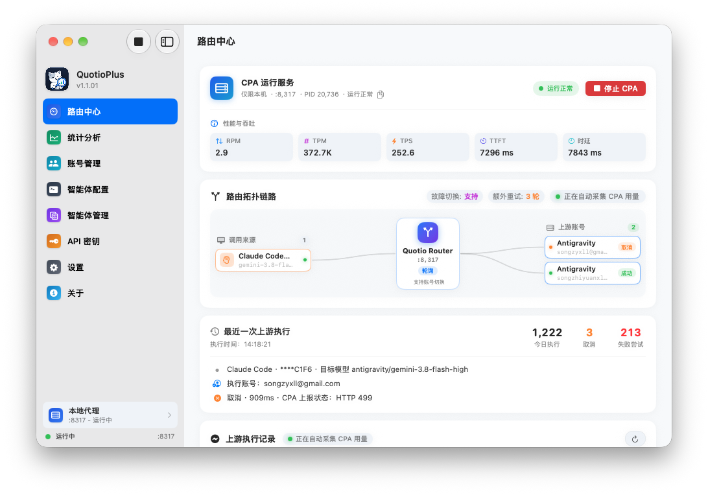
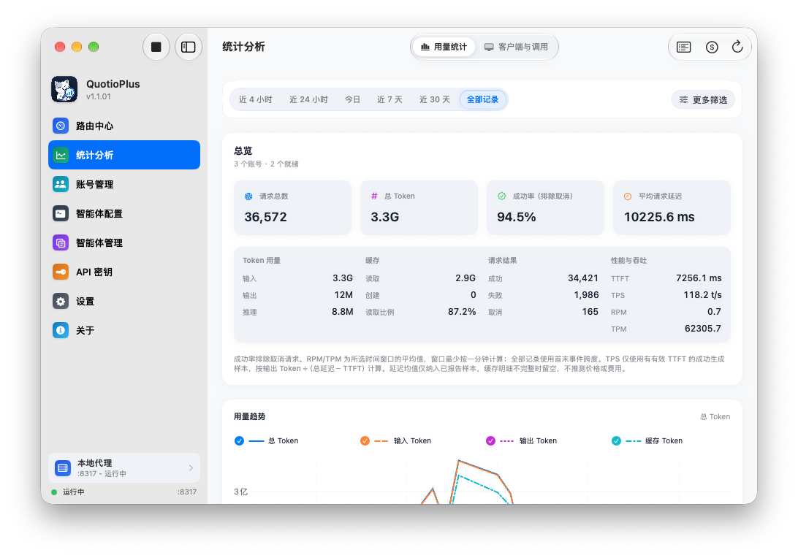
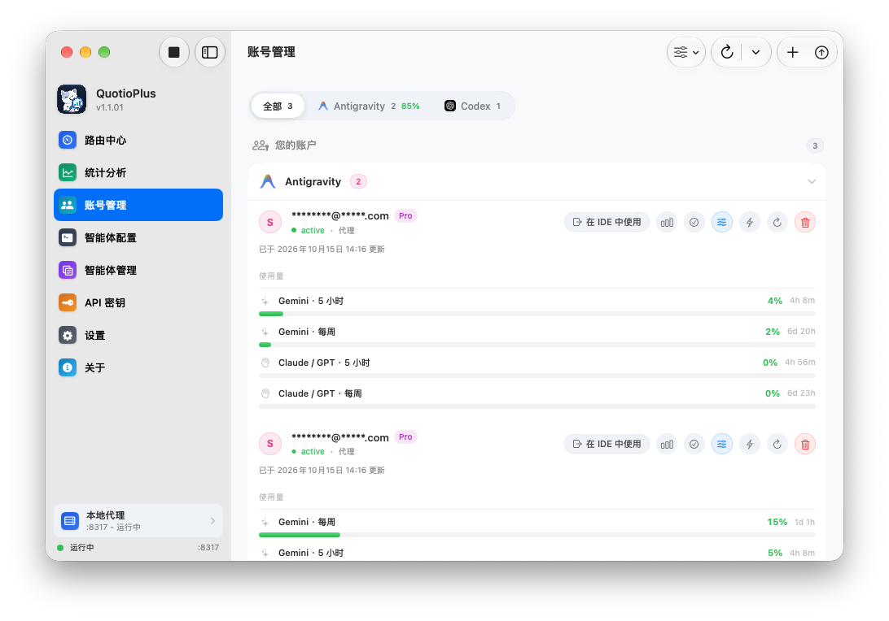

# QuotioPlus


<p align="left">
  <a href="https://github.com/Geoege-xll/quotio/releases"></a>
  <a href="https://linux.do"></a>
  
  <a href="LICENSE"></a>
</p>

[English](README.md) · **简体中文**

**QuotioPlus 1.1.01** 是基于 [Trong Nguyen（@nguyenphutrong）](https://github.com/nguyenphutrong) 的开源项目 [Quotio](https://github.com/nguyenphutrong/quotio) 进行二次开发的原生 macOS 应用，用于管理 AI 账号、代理服务、客户端配置、配额和使用统计。

> **来源声明与致谢**：本项目是在原作者代码基础上的独立二次开发版本。感谢 Trong Nguyen 和 Quotio 的所有贡献者开放源码、持续维护，为本项目提供了基础。我们保留原项目的版权声明与 MIT 许可证；QuotioPlus 的版本、更新和问题反馈由本仓库独立维护。

[下载 1.1.01](https://github.com/Geoege-xll/quotio/releases/tag/v1.1.01) · [发行说明](docs/releases/1.1.01.md) · [LINUX DO 社区讨论](https://linux.do) · [反馈问题](https://github.com/Geoege-xll/quotio/issues) · [原作者项目](https://github.com/nguyenphutrong/quotio)

## 项目截图

以下为 **QuotioPlus 1.1.01** 的原生 macOS 界面实拍（macOS 15+ Apple Silicon 原生呈现）：

**路由中心：实时拓扑、上下游请求追踪与链路状态**



| 统计分析：用量统计与趋势热力图 | 智能体管理：缓存、空间与工作区维护 |
| --- | --- |
| [](screenshots/v1.1.01/usage-analytics.png) | [](screenshots/v1.1.01/agent-workspace.png) |

**账号管理：多服务商账号池、实时配额进度与重置周期**



> 点击预览图可查看全尺寸高分辨率原图。

## 1.1.01 的主要功能

- **路由中心与拓扑监控**：可视化展示智能体客户端至模型提供商的请求链路与实时吞吐指标；最近一次请求追踪支持失败原因就地直接展开，链路排查快速直观。
- **统计分析与多源用量看板**：全面整合 Claude Code、Codex CLI、OpenCode 等智能体客户端的使用记录，细粒度统计请求总量、Token 明细与平均延迟，提供趋势图与活动热力图。
- **智能体管理与工作区存储**：透明化分析各智能体客户端的磁盘空间占用与会话存储，支持一键安全清理缓存数据。
- **多渠道账号与配额管理**：统一管理 Antigravity、Claude、OpenAI、Copilot 等服务商账号，实时呈现配额进度条、重置周期与 IDE 扫描绑定。
- **原生 macOS 设计系统规范（外方内圆）**：严格遵循 Squircle 超椭圆卡片与 Capsule 胶囊控件体系，确立单字段行内即时应用（`QuotioInlineApplyField`）规范与基线修改感知（Dirty Tracking）。
- **CPA v8 代理深度集成**：完整支持 CLIProxyAPI 8.x，提供动态会话保持（Session Affinity）、重试机制与热重载高级设置。
- **高性能 SQLite 引擎**：持久化汇总增量扫描，减少大历史数据的重复加载与内存消耗。
- **独立更新与上游兼容**：应用更新基于本仓库维护；保留上游兼容机制与诊断维护入口。

客户端 Token、CPA 网关请求和工具调用是不同统计口径，分别展示。清理统计不会删除客户端源日志，现存日志可在后续采集时重新导入。

## 安装

要求 **macOS 15 或更新版本，以及 Apple Silicon Mac（M1 或更新芯片）**。从本仓库的 [Releases](https://github.com/Geoege-xll/quotio/releases) 下载 `QuotioPlus-1.1.01.dmg` 或 ZIP，应用显示名称为 **QuotioPlus**，发布构建仅包含 arm64，不再支持 Intel Mac。

每个发行版会注明是否经过 Developer ID 签名及 Apple 公证。未配置发布证书时，安装包使用临时签名，macOS 可能要求额外确认。自动安装更新仅在本项目的 Sparkle 签名配置完整时启用；其他构建通过本仓库发布页手动更新。

当前没有本二开版的官方 Homebrew 安装入口。原作者的 `nguyenphutrong/tap` 安装的是上游 Quotio。

## 从源码构建

```bash
git clone https://github.com/Geoege-xll/quotio.git
cd quotio
open Quotio.xcodeproj
```

使用 Xcode 26.1 或更新版本，选择 `QuotioPlus` scheme 后构建运行。也可从终端构建：

```bash
xcodebuild -project Quotio.xcodeproj -scheme QuotioPlus \
  -configuration Debug -destination 'platform=macOS' build
```

应用 Bundle ID 为 `com.app.george.quotioplus`。本地签名或开发覆盖配置放在不受版本管理的 `Config/Local.xcconfig`，示例见 [Local.xcconfig.example](Config/Local.xcconfig.example)。发布流程见 [RELEASE.md](RELEASE.md)。

## 开源来源与感谢

| 项目 | 在 QuotioPlus 中的作用 |
| --- | --- |
| [Quotio · Trong Nguyen 与贡献者](https://github.com/nguyenphutrong/quotio) | 二次开发的主要代码基础：原生应用、账号、配额、代理和客户端管理。 |
| [CLIProxyAPI · router-for-me](https://github.com/router-for-me/CLIProxyAPI) | 应用管理的代理服务。 |
| [EasyCLIProxyAPI · router-for-me](https://github.com/router-for-me/EasyCLIProxyAPI) | 仪表盘 usage 统计口径、筛选和展示行为的参考。 |
| [AIUsage · sylearn 与贡献者](https://github.com/sylearn/AIUsage) | 用量统计、调用分析和部分原生界面的移植与参考，详见[来源说明](docs/licenses/AIUsage-attribution.md)。 |
| [cc-switch · farion1231 与贡献者](https://github.com/farion1231/cc-switch) | 客户端配置与模型映射行为的参考。 |
| [Sparkle](https://github.com/sparkle-project/Sparkle) | macOS 应用更新框架。 |

感谢以上作者和社区贡献者。本仓库保留上游提交历史，并将本项目首发前的开发改动整理为一个 `1.0.0` 版本提交，方便阅读、发布和后续维护。

## 社区与认可

> 🏅 **本项目积极参与并认可 [LINUX DO 社区](https://linux.do)。**

<p align="left">
  <a href="https://linux.do"></a>
</p>

- **[LINUX DO 社区](https://linux.do)**：欢迎在 LINUX DO 社区交流 QuotioPlus 的使用心得、配置技巧与使用建议。
- **问题反馈**：如遇程序异常或新功能需求，请在 [Geoege-xll/quotio Issues](https://github.com/Geoege-xll/quotio/issues) 提交。

## 许可证与维护

应用主体沿用 [MIT License](LICENSE)，保留原作者 `Copyright (c) 2025 Trong Nguyen`。AIUsage 移植部分保留来源、修改说明及 [Apache License 2.0](docs/licenses/AIUsage-Apache-2.0.txt)。其他依赖分别遵循其许可证。

二开维护和上游同步方式见 [二次开发维护指南](docs/SECONDARY_DEVELOPMENT.md)。本项目的问题请在 [Geoege-xll/quotio Issues](https://github.com/Geoege-xll/quotio/issues) 提交。
